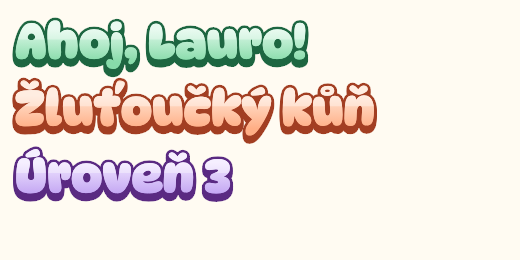
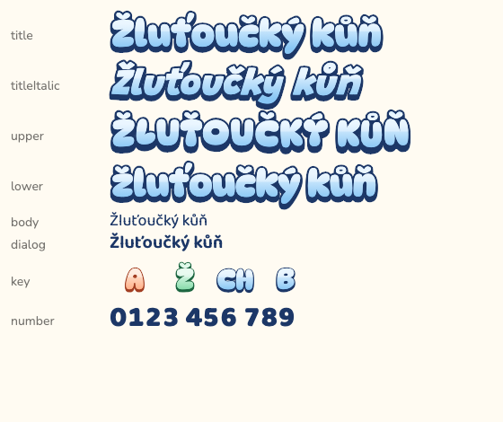
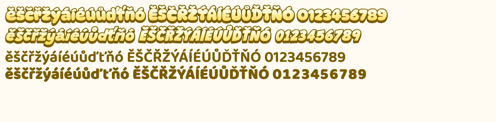

# CuteKidFonts

Chubby, embossed, pastel kid typography for Flutter and Flame — one package
so every kids' app shares the same look.



- **Bundled OFL fonts** (offline, deterministic builds — no `google_fonts`),
  all passing an automated Czech diacritics test.
- **Bubble effect** in code: extrusion → outline → gradient face → gloss.
- **Five named palettes** — apps never hard-code hex.
- **Roles** instead of ad-hoc styles: `title`, `titleItalic`, `upper`, `lower`,
  `body`, `dialog`, `key`, `number`.
- **Material**: `KidTextTheme.apply(textTheme)` puts the whole app on the kid faces.
- **One face per string**: `KidFonts.familyFor(text)` picks the first face that
  covers the whole text (Vietnamese → Baloo 2, Cyrillic → Nunito, Greek → system).
- **Flame-free core.** Games add the separate `cute_kid_fonts_flame` package:
  `KidTextPaint` for dynamic text, `KidBubbleComponent` for static sprites.
  `rasterizeBubble()` / `KidRasterCache` live in the core.

## Install

```yaml
dependencies:
  cute_kid_fonts:
    git:
      url: https://github.com/lioilsources/CuteKidFonts.git
      ref: v0.2.1
```

Flame games depend on the Flame package **instead** — it re-exports the core
(`cute_kid_fonts_flame.dart`) and the test helper
(`cute_kid_fonts_flame_testing.dart`). Don't list `cute_kid_fonts` as well: pub
resolves the Flame package's in-repo core to a commit, and a second entry pinned
to the tag conflicts with it.

```yaml
dependencies:
  cute_kid_fonts_flame:
    git:
      url: https://github.com/lioilsources/CuteKidFonts.git
      ref: v0.2.1
      path: packages/cute_kid_fonts_flame
```

While developing next to the package, override with a path:

```yaml
dependency_overrides:
  cute_kid_fonts:
    path: ../CuteKidFonts
```

## Usage

```dart
import 'package:cute_kid_fonts/cute_kid_fonts.dart';

BubbleText('Ahoj!', role: KidRole.title, palette: KidPalette.mint);
BubbleText('úroveň 3', role: KidRole.upper);            // → ÚROVEŇ 3, +1.5 spacing
BubbleText('0420', role: KidRole.number);               // tabular figures, flat
BubbleText('Ahoj!', size: 64, flat: true);              // no outline/extrusion

KidKeyLabel('Ž', size: 36);                             // square box, centred
KidKeyLabel.fit('CH', keyHeight: 64);                   // font = 0.55 × key height

Text('Pojď si hrát', style: KidTheme.of(context).style(KidRole.body));
Text(word, style: KidTheme.of(context).style(KidRole.body, forText: word)); // one face per string
```

### Material apps

```dart
final base = ThemeData(colorSchemeSeed: Colors.teal);
MaterialApp(theme: base.copyWith(textTheme: KidTextTheme.apply(base.textTheme)));
```

display / headline / title → DynaPuff 700 (flat), body → Baloo 2 400,
label → Baloo 2 600. Sizes, colours, heights and spacing of the base theme are
kept.

### Other scripts

A string is never split across faces in `BubbleText`, `KidBubblePainter` or
`style(…, forText:)` — the first face of `[role face, Baloo 2, Nunito]` that
covers the whole text is used:

| Script | Title roles | Body roles |
|---|---|---|
| Latin incl. cs pl sk ro tr hr sl da nb sv de fr es pt it nl id | DynaPuff | Baloo 2 |
| Vietnamese, pinyin | Baloo 2 | Baloo 2 |
| Devanagari (Hindi) | Baloo 2 | Baloo 2 |
| Cyrillic (ru uk bg sr) | Nunito | Nunito |
| Greek, Hebrew, Arabic, CJK | — (`familyFor` → `null`, use the system font) | — |

```dart
final family = KidFonts.familyFor(text, role: KidRole.title); // String? 
KidFonts.covers(KidFonts.dynaPuff, text);                     // bool
```

Coverage comes from `lib/src/coverage.g.dart`, generated from the font files
by `dart run tool/gen_coverage.dart`; a test fails when it is stale.

Optional app-wide defaults:

```dart
KidTheme(
  data: const KidThemeData(
    palette: KidPalette.sky,
    onDark: true,        // flat text uses the palette's light colour
    sizeScale: 1.2,
    keyPalettes: {       // default: vowels peach, consonants sky, diacritics mint
      KidKeyGroup.vowel: KidPalette.lemon,
      KidKeyGroup.consonant: KidPalette.sky,
      KidKeyGroup.diacritic: KidPalette.lavender,
    },
  ),
  child: app,
);
```

### Flame

```dart
import 'package:cute_kid_fonts_flame/cute_kid_fonts_flame.dart';

// Static text — rasterised once, cached, shown as a sprite.
add(KidBubbleComponent(text: 'game over', role: KidRole.upper, palette: KidPalette.peach));

// Dynamic text (score, timer) — plain TextPaint, face colour + extrusion shadow.
TextComponent(text: '0420', textRenderer: KidTextPaint.of(KidRole.number, KidPalette.lemon));

// Or raw (core package, no Flame needed): an image to draw yourself.
final raster = await KidRasterCache.instance.get('Hotovo!', palette: KidPalette.mint);
```

### Golden tests in your app

```dart
// test/flutter_test_config.dart
import 'package:cute_kid_fonts/cute_kid_fonts_testing.dart';

Future<void> testExecutable(FutureOr<void> Function() testMain) async {
  TestWidgetsFlutterBinding.ensureInitialized();
  await loadKidFonts();
  await testMain();
}
```

## Roles

| Role | Face | Default | Effect |
|---|---|---|---|
| `title` | DynaPuff 700 | 48 | bubble |
| `titleItalic` | Grandstander Italic 900 (true italic, no skew) | 48 | bubble |
| `upper` | DynaPuff 700, UPPERCASE, +1.5 spacing | 48 | bubble |
| `lower` | DynaPuff 700, lowercase | 48 | bubble |
| `body` | Baloo 2 400 | 18 | flat |
| `dialog` | Baloo 2 600 | 20 | flat |
| `key` | DynaPuff 700, thinner outline (0.10) | 36 | bubble |
| `number` | Baloo 2 800, tabular figures | 32 | flat |

Fallback for every role: Baloo 2, then Nunito — Baloo 2 covers pinyin tone
marks (Ǐ ǒ ǚ…) that DynaPuff lacks.



## Palettes

| Palette | Face (light → mid) | Outline |
|---|---|---|
| `peach` | peach | brick |
| `mint` | mint | forest |
| `lavender` | lavender | plum |
| `lemon` | lemon | mustard |
| `sky` | sky | navy |

Every outline colour has ≥ 4.5:1 contrast against white and against its own
face; every face colour ≥ 4.5:1 against the dark gallery background (tested).

## Czech diacritics

Every bundled face must cover
`ěščřžýáíéúůďťňó ĚŠČŘŽÝÁÍÉÚŮĎŤŇÓ 0123456789` (+ `CH` and punctuation).
`test/diacritics_test.dart` reads each font's `cmap` and fails on any missing
glyph, so nothing can silently fall back.



> **Fredoka was rejected.** The original plan used Fredoka for titles, but it
> lacks `ě č ř ů ď ť ň` (and uppercase forms) and has no tabular figures.
> DynaPuff replaced it for titles/keys; Baloo 2 took over `number`.

## Example gallery

`example/` — roles × palettes, a Czech keyboard, the diacritics sheet, a 50-row
performance list and a Flame scene. Toggle light/dark in the app bar.

```bash
cd example && flutter run -d macos
```

## Fonts & licences

All fonts are under the SIL Open Font License 1.1; licence texts live next to
the files in `fonts/`.

| File | Project |
|---|---|
| `DynaPuff-Variable.ttf` | [DynaPuff](https://github.com/googlefonts/dynapuff) |
| `Baloo2-Variable.ttf` | [Baloo 2](https://github.com/EkType/Baloo2) |
| `Grandstander-Italic-Variable.ttf` | [Grandstander](https://github.com/Etcetera-Type-Co/Grandstander) |
| `Nunito-Variable.ttf`, `Nunito-Italic-Variable.ttf` | [Nunito](https://github.com/googlefonts/nunito) |

Package code: MIT (see `LICENSE`).
